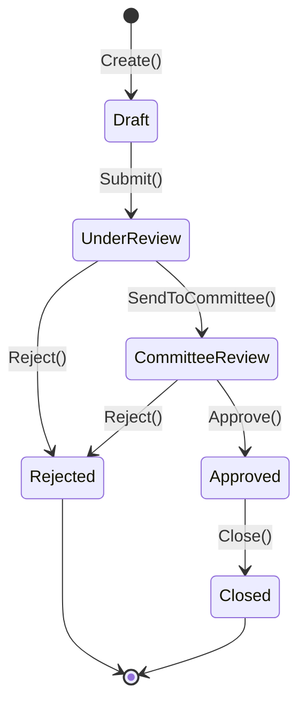

# State Pattern Kata (.NET 10 Modular Monolith)

A production-grade kata demonstrating the State Pattern combined with Domain-Driven Design (DDD) principles, built using a Modular Monolith architecture in C# / .NET 10.

## 🎯 Kata Overview & Domain Context

This kata models a **Loan Case Application System (Dossier de Prêt)**. The goal is to enforce complex state transitions and business invariants dynamically using the State Pattern, preventing invalid domain operations without relying on bloated if/else or switch statements inside the main entity.

## 📋 Business Rules & State Workflow

A `LoanCase` goes through a strict life cycle with specific business rules governing each transition. The behaviour of each state lives in a dedicated class under `LoanCase.Domain/States/`, and the aggregate delegates every action to its current state (`LoanCase.Submit()`, `LoanCase.Approve()`, …).

### The six states

| State | `LoanCaseStatus` | State class | Meaning |
|---|---|---|---|
| Draft | `Draft` | `DraftState` | Initial state when the loan application is created. |
| Under Review | `UnderReview` | `UnderReviewState` | Risk analysis performed by a loan officer / analyst. |
| Committee Review | `CommitteeReview` | `CommitteeReviewState` | Awaiting the credit committee vote; the supporting documents are sealed. |
| Approved | `Approved` | `ApprovedState` | Accepted by the committee, awaiting the signed offer and the disbursement. |
| Rejected | `Rejected` | `RejectedState` | Refused — **terminal state**. |
| Closed | `Closed` | `ClosedState` | Closed (disbursed) — **terminal state**. |

### Allowed transitions

| Current state | Action | Resulting state |
|---|---|---|
| — | `Create()` | `Draft` |
| `Draft` | `Submit()` | `UnderReview` |
| `UnderReview` | `SendToCommittee()` | `CommitteeReview` |
| `UnderReview` | `Reject(rejectionDetails)` | `Rejected` |
| `CommitteeReview` | `Approve()` | `Approved` |
| `CommitteeReview` | `Reject(rejectionDetails)` | `Rejected` |
| `Approved` | `Close()` | `Closed` |



### How an illegal transition is rejected

`LoanCaseState` declares every action as a `virtual` method whose default implementation throws `InvalidLoanCaseStateActionException`. A concrete state only overrides the actions it accepts:

```csharp
public sealed class DraftState : LoanCaseState
{
    public override LoanCaseStatus Status => LoanCaseStatus.Draft;

    public override void Submit()
    {
        _loanCase.TransitionTo(new UnderReviewState(_loanCase));
    }
}
```

Consequently, calling `Approve()` on a `DraftState` throws — there is no `if/else` chain inside the aggregate, and the legal transitions live in one single place per state. The message names both the rejected action and the current state (`LoanCaseMessages.ActionNotAllowedInState`). `StateTransitionTest` enumerates the full transition matrix and asserts that a forbidden action throws **and leaves the aggregate untouched**.

### Business invariants

The `LoanCase` cannot be created unless:

- the requested amount is greater than or equal to zero (`Amount` value object, `InvalidAmountValueException`);
- at least one supporting document is provided (`LoanCaseAttachedDocumentException`);
- **all** mandatory document types are present — `IdentityCard`, `Payslip`, `ProofOfAddress`, `TaxReturn` (`LoanCaseAttachedDocumentException`). A partial set is rejected;
- each document respects the allowed extensions (`.pdf`, `.png`, `.jpeg`, `.jpg`) and a strictly positive size (`AttachedDocument` value object).

A rejection always carries a mandatory reason and a `.pdf` rejection letter (`RejectionDetails` / `DocumentFile` value objects).

> **Note:** the Draft state does **not** yet expose an amendment action — the application details and the supporting documents are frozen from creation. The state name and its `LoanCaseStatus` comment mention "modifiable", but no `Amend`/`Update` behaviour is implemented yet.

### State journal (snapshot of each state)

The **aggregate owns its journal**. `LoanCase.StateHistory` holds the immutable `LoanCaseStateSnapshot` entries, and `RecordState(...)` appends the current state of the dossier to it:

- the history is **append-only** — an entry is never updated nor deleted (`ILoanCaseSnapshotRepository` only exposes `AddAsync` and `GetByVersionAsync`);
- an entry is a **Memento**: an immutable value object (a `record` whose collections are `ImmutableArray`), built once by the aggregate and never altered afterwards;
- an entry carries the full state of the dossier (status, number, amount, created at, supporting documents, rejection details), the `SavedAt` timestamp, the `CreatedBy` actor and the `RolledBackFrom` link (the `CreatedBy` actor is currently only supplied by the `Restore` use case);
- `Version` is **derived** from the journal (`StateHistory.Count`), never incremented by hand: the sequence therefore cannot be duplicated nor skipped, and it always equals the number of recorded states (`LoanCaseLifecycleTest` asserts `version == snapshot count` at each step of the life cycle);
- the aggregate rebuilds its current state from a snapshot through `LoanCaseStateFactory.FromStatus(...)`, used by both `Rehydrate` (loading from the repository) and `Restore`.

`Rehydrate` **validates** the journal it is given: the last entry must belong to the dossier, its sequence must be the last one (no gap) and its status must be the current status. An inconsistent journal is rejected with `InvalidLoanCaseSnapshotException`.

### The `Restore` use case (rollback)

`RestoreLoanCaseStateHandler` rolls a dossier back to a previously recorded version:

1. it loads the dossier from the repository;
2. it asks the aggregate to roll back: `LoanCase.Restore(version, savedAt, createdBy)` — the aggregate **resolves the target entry in its own journal**, applies its content **and records the rollback** (it returns the new entry);
3. it persists the entry returned by the domain (`snapshotService.SaveAsync`).

The rollback is therefore **atomic in the domain**: the aggregate is never left in a restored state without its trace. The journal stays append-only and auditable: a rollback is never an erasure, it is a new recorded state that references the state it came from — rolling back to version `1` produces version `4` whose content is the content of version `1`.

`Restore` is refused when:

- the current state is `Closed` — a closed dossier is final;
- the requested version is unknown to the dossier (`LoanCaseSnapshotNotFoundException`).

The handler therefore depends only on `ILoanCaseRepository` and `ILoanCaseSnapshotService`: it never reads the journal itself, the aggregate owns it.

## 🧩 Composition Root & Service Seam

The command handlers never build their collaborators themselves. They receive them through their constructor and depend on the **abstraction**, never on the implementation:

```csharp
public sealed class ApproveLoanCaseHandler(
    ILoanCaseRepository loanCaseRepository,
    ILoanCaseSnapshotService snapshotService)
    : ICommandHandler<ApproveLoanCaseCommand, ApproveLoanCaseResponse>
```

`ILoanCaseSnapshotService` (Application layer) is the seam: `LoanCaseSnapshotService` is its only implementation today, and it is the natural place to host the Unit of Work, the logging or the metrics of the state journal.

Because of that, the concrete implementations are wired in **one single place** — the composition root — and nowhere else:

| Layer | Role |
|---|---|
| `LoanCase.Application/Services/ILoanCaseSnapshotService.cs` | The contract the handlers depend on. |
| `LoanCase.Application/Services/LoanCaseSnapshotService.cs` | The implementation (snapshot creation + persistence). |
| `LoanCase.Tests/LoanCaseTestContext.cs` | The composition root of the kata: it builds the repositories, the snapshot service and the 7 handlers, and hands them over to the test classes. |

Adding a decorator (transaction, logging, metrics) is a one-line change **in the composition root** — no handler is touched:

```csharp
SnapshotService = new LoanCaseSnapshotService(SnapshotRepository);
// becomes, for instance:
// SnapshotService = new TransactionalLoanCaseSnapshotService(new LoanCaseSnapshotService(SnapshotRepository), unitOfWork);
```

> In a real application the composition root is the host (`Program.cs` / the infrastructure layer). The kata has no host, so the test project plays that role.

## 🧬 Design patterns used

### State — `LoanCase.Domain/States/`

| Role (GoF) | Implementation |
|---|---|
| Context | `LoanCase` holds a reference to its current state and delegates every action to it (`Submit`, `Approve`, `Close`, …) |
| State interface | `LoanCaseState` declares every action as `virtual`; the default implementation throws `InvalidLoanCaseStateActionException` |
| Concrete states | `DraftState`, `UnderReviewState`, `CommitteeReviewState`, `ApprovedState`, `RejectedState`, `ClosedState` — each overrides only the actions it accepts and calls `TransitionTo(...)` |
| Client | The command handlers, which only know the aggregate |

`TransitionTo` is `internal`: a state can only be changed from inside the domain.

### Memento — `LoanCase.Domain/Snapshot/`

| Role (GoF) | Implementation |
|---|---|
| Originator | `LoanCase` — it produces its own mementos (`RecordState`) and restores itself from one (`Restore`) |
| Memento | `LoanCaseStateSnapshot` — an immutable `record` holding the full state of the dossier, its `Version` and the `RolledBackFrom` link |
| Caretaker | The aggregate itself owns the history (`StateHistory`); the application service (`LoanCaseSnapshotService`) persists it |

Two deliberate deviations from the textbook, both driven by the DDD context:

- **The memento is not hidden.** In the GoF version the memento is a private nested class that nobody may read. Here the snapshot is a persisted audit record: it has to be readable (timeline, rollback, audit trail) and storable, so it lives in its own file with a public API. What is preserved is the rule that matters — the memento is **immutable** (a `record` with `ImmutableArray` collections and no setter), so a written journal entry can never be altered.
- **The caretaker is the originator.** Since the aggregate owns its journal, it resolves the target version of a rollback by itself instead of receiving a snapshot from the outside.

## 🗂️ Where the code lives

| Concern | Location |
|---|---|
| Aggregate & business rules | `Src/Modules/LoanCase/LoanCase.Domain/LoanCase.cs` |
| State journal (owned by the aggregate) | `Src/Modules/LoanCase/LoanCase.Domain/LoanCase.cs` (`StateHistory`, `RecordState`) |
| State journal entry | `Src/Modules/LoanCase/LoanCase.Domain/Snapshot/LoanCaseStateSnapshot.cs` |
| State classes | `Src/Modules/LoanCase/LoanCase.Domain/States/` |
| State factory (rehydration) | `Src/Modules/LoanCase/LoanCase.Domain/Factory/LoanCaseStateFactory.cs` |
| Outbound ports | `Src/Modules/LoanCase/LoanCase.Domain/Port/Out/` |
| Command handlers | `Src/Modules/LoanCase/LoanCase.Application/Command/` |
| State journal service (contract + impl.) | `Src/Modules/LoanCase/LoanCase.Application/Services/` |
| Composition root | `Src/Modules/LoanCase/LoanCase.Tests/LoanCaseTestContext.cs` |
| Domain messages & exceptions | `Src/Modules/LoanCase/LoanCase.Domain/Messages/`, `.../Exceptions/` |
| Tests | `Src/Modules/LoanCase/LoanCase.Tests/Units/`, `.../Builder/`, `.../Repository/` |

## 🛠️ Engineering Standards

- **.NET 10:** Built on the latest modern, high-performance .NET runtime.
- **Central Package Management (CPM):** All NuGet package versions are managed globally via `Directory.Packages.props`.
- **Domain-Driven Design (DDD):** Rich domain models, encapsulation, and immutable Value Objects.
- **Code Formatting:** Clean, automated styling aligned with Csharpier and `.editorconfig`.

## ⚠️ Known Limitations & Technical Debt

### Missing transaction to guarantee use-case atomicity

Most use cases perform **two separate writes** that must succeed or fail together:

1. appending a new `LoanCaseStateSnapshot` (state history / audit trail);
2. updating the `LoanCase` aggregate in its repository.

These writes are currently executed sequentially, **outside of any transaction**:

```csharp
await snapshotService.ExecuteAsync(loanCase, ct: ct);
await loanCaseRepository.UpdateAsync(loanCase, ct);
```

If the second call fails (database outage, optimistic concurrency conflict, network error, etc.), the snapshot has already been persisted while the aggregate keeps its previous state — or vice versa. The snapshot history no longer reflects the actual loan case, leaving the system **inconsistent**.

The use cases affected are `Create`, `Submit`, `SendToCommittee`, `Approve`, `Reject`, `Close` and `Restore`.

> The in-memory repositories used by the test suite mask this issue, because their writes never fail.

**Planned fix:** introduce a transactional boundary (Unit of Work / `IDbContextTransaction`) so that the snapshot append and the aggregate update are committed atomically. The snapshot stays append-only and versioned — only the persistence boundary changes.

> The seam already exists: the handlers depend on `ILoanCaseSnapshotService`, not on its implementation. The transaction is plugged in at the **composition root** (the single place where the concrete implementations are wired) — no handler has to be modified.

**Acceptance criteria:**
- [ ] A shared transaction abstraction (e.g. `IUnitOfWork`) usable by every handler.
- [ ] Snapshot write and aggregate update committed within a single transaction.
- [ ] A test proving the rollback: if the update fails after the snapshot write, no snapshot remains persisted.

---

## 📖 Command Cheat Sheet & Explanations

Here is a complete breakdown of all the terminal commands used to build this architecture from scratch with a clean, flat directory structure (avoiding redundant intermediate technical folders).

### 1. Solution & Git Initialization
```bash
# Initialize a git repository to track version control
git init
```

### 2. Creating Domain and Test Libraries (Flattened Structure)
To create physical folders and projects directly matching their purpose without redundant nesting, we use the `dotnet new` command with explicit outputs:

```bash
# Create the Domain Class Library directly in its dedicated module path
dotnet new classlib -o Src/Modules/LoanCase/LoanCase.Domain -n LoanCase.Domain

# Create the xUnit Test Project directly in its dedicated test path
dotnet new xunit -o Src/Modules/LoanCase/LoanCase.Tests -n LoanCase.Tests
```

🔍 **Explanation of the Options:**
- `dotnet new`: Instructs the .NET CLI to generate a new project from a built-in template.
- `classlib / xunit`: Specifies the template type. `classlib` generates a pure C# library, while `xunit` generates a pre-configured unit testing project.
- `-o (or --output)`: Defines the exact physical directory on your disk where the project files will be created.
- `-n (or --name)`: Defines the internal project name, the `.csproj` file name, and the root namespace for the C# files.

### 3. Solution Integration & Project References
Once projects are created on the disk, they must be registered in the solution file (`.sln`) and linked if they depend on each other:

```bash
# Register the Domain project in the solution file
dotnet sln add Src/Modules/LoanCase/LoanCase.Domain/LoanCase.Domain.csproj

# Register the Tests project in the solution file
dotnet sln add Src/Modules/LoanCase/LoanCase.Tests/LoanCase.Tests.csproj

# Link the Test project to the Domain project so tests can access domain logic
dotnet add Src/Modules/LoanCase/LoanCase.Tests/LoanCase.Tests.csproj reference Src/Modules/LoanCase/LoanCase.Domain/LoanCase.Domain.csproj
```

🔍 **Explanation of the Options:**
- `dotnet sln add [path]`: Injects the project reference into the `.sln` file so that IDEs like JetBrains Rider can display and build it.
- `dotnet add [target] reference [dependency]`: Establishes a project-to-project reference, allowing the test suite to compile and test the domain classes.

### 4. Configuration Generation via CLI
```bash
# Automatically generate a standard .editorconfig file for C# code style
dotnet new editorconfig
```

---

## 🚀 Getting Started

1. Open the solution file `pattern-state-kata.sln` in JetBrains Rider or your preferred .NET IDE.
2. Restore NuGet dependencies:
   ```bash
   dotnet restore
   ```
3. Run the test suite to ensure everything is green:
   ```bash
   dotnet test
   ```
4. Run the test suite with coverage:
   ```bash
   dotnet test --collect:"XPlat Code Coverage"
   ```

## 🧪 Test Suite

| Test file | What it covers |
|---|---|
| `StateTransitionTest` | The full transition matrix: allowed transitions move the aggregate, forbidden ones throw and leave it untouched. |
| `LoanCaseLifecycleTest` | The end-to-end life cycle through the handlers, asserting the status and the journal version at each step. |
| `CreateLoanCaseTest` | Creation invariants (mandatory documents, amount, numbering). |
| `SubmitLoanCaseTest`, `SendLoanCaseToCommitteeTest`, `ApproveLoanCaseTest`, `RejectLoanCaseTest`, `CloseLoanCaseTest` | One use case each: success path, snapshot appended, rejection of an illegal transition. |
| `RestoreLoanCaseStateTest` | Rollback to a previous version, appended snapshot with `RolledBackFrom`, and the failure cases (unknown dossier, unknown version, closed dossier). |
| `LoanCaseStateHistoryTest` | The journal guarantees: continuous sequence, captured state, append-only rollback, unknown version refused, and the consistency checks performed by `Rehydrate`. |